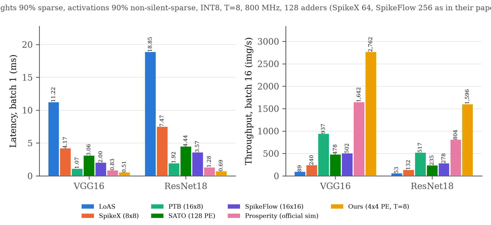
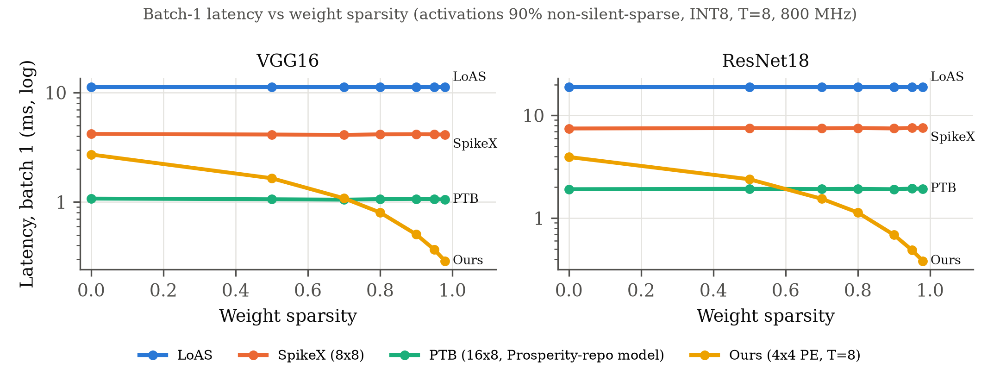
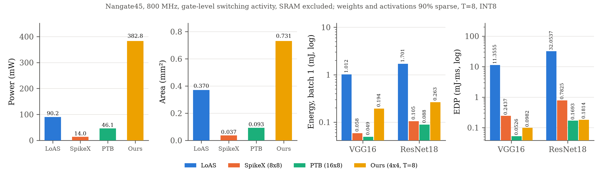

# DAC2027 dataflow: cycle-accurate latency and throughput on VGG16 and ResNet18

This folder models the design in `DAC2027_accelerator_explained_rows.pdf`. It is a weight-stationary array where spike trains stream right along the rows and running sums move down the columns. Each PE has T adders, filters are packed offline into shared columns, and pixels are packed at run time into groups. The model is compared with LoAS (numbers from `EnergySpeedupSim.zip`), PTB (`Baselines/PTB/ptb.pdf`) and SpikeX (`spikex.pdf`).

```bash
python3 verify.py          # must print three [ok] lines
python3 run_all.py         # main tables -> results/main_tables.md, main_summary.json
python3 run_all.py sweep   # weight-sparsity sweep -> results/sweep_summary.json
python3 sensitivity.py     # design knobs at 128 adders -> results/sensitivity.json
python3 plots.py           # results/*.png
```

The full run takes about 5 minutes on 8 cores.

## Headline (weights 90% sparse, activations 90% non-silent-sparse, INT8, T=8, 800 MHz)

This is the workload the author specified in `current_arch/REPORT.md` section 15. Our design has the best batch-1 latency and the best batch-16 throughput on both networks.

| Network | Design | Latency b=1 (ms) | Ours faster by | Throughput b=16 (img/s) | Ours higher by |
|---|---|---:|---:|---:|---:|
| VGG16 | LoAS | 11.217 | 22.1x | 89 | 31.0x |
| VGG16 | SpikeX (8x8) | 4.170 | 8.2x | 240 | 11.5x |
| VGG16 | PTB (16x8) | 1.067 | 2.1x | 937 | 2.9x |
| VGG16 | SATO (128 PE, Prosperity-repo model) | 3.060 | 6.0x | 478 | 5.8x |
| VGG16 | SpikeFlow (16x16) | 2.002 | 3.9x | 502 | 5.5x |
| VGG16 | Prosperity (official simulator) | 0.833 | 1.6x | 1,642 | 1.7x |
| VGG16 | **Ours (4x4 PE x 8 adders)** | **0.507** | – | **2,762** | – |
| ResNet18 | LoAS | 18.846 | 27.4x | 53 | 30.1x |
| ResNet18 | SpikeX (8x8) | 7.472 | 10.9x | 132 | 12.0x |
| ResNet18 | PTB (16x8) | 1.915 | 2.8x | 517 | 3.1x |
| ResNet18 | SATO (128 PE, Prosperity-repo model) | 4.444 | 6.5x | 235 | 6.8x |
| ResNet18 | SpikeFlow (16x16) | 3.568 | 5.2x | 278 | 5.7x |
| ResNet18 | Prosperity (official simulator) | 1.282 | 1.9x | 804 | 2.0x |
| ResNet18 | **Ours** | **0.688** | – | **1,596** | – |



The full tables, with cycles and img/s per adder, are in `results/main_tables.md`.

* **LoAS** uses the zip's closed form and statistics unchanged: 16 TPPEs, `matches + 21` per 128-chunk, and p = 0.261. `verify.py` reproduces the zip exactly: VGG16 = 8,973,849 cycles = 11.2173 ms. The zip has no ResNet18 entry, so the same formula was applied to the standard CIFAR ResNet18. The zip's p does not depend on weight sparsity, so LoAS is the same on every workload below.

* **Prosperity** numbers come from the **official Prosperity simulator** (github Prosperity-main, MIT, vendored unmodified in `third_party/prosperity`), run by `prosperity_official.py`.
  * **Configuration:** Tbl. III, i.e. tiles m=256, k=16, n=128 and 128 PEs. The simulator includes its DRAM stalls and LIF latency.
  * **Inputs:** our layers and tensors, with T=8 and the same seeds as above.
  * **The one replacement:** the official per-row Python prefix search (the authors use a CUDA kernel for speed) is swapped for a vectorized version. `prosperity_official.py verify` checks that it gives identical output on random tiles and on tiles of the authors' real spikes.
  * **Reproduction of the paper's reference results** (`reference/time_reference.xlsx`, 500 MHz), on the authors' real spike data:

    | Benchmark | Prosperity, run here | Paper reference | PTB, run here | Paper reference |
    |---|---:|---:|---:|---:|
    | VGG16 CIFAR10 | 21.504 ms | 21.504 ms | 145.917 ms | 145.917 ms |
    | VGG16 CIFAR100 | 33.608 ms | 33.577 ms | 316.902 ms | 316.902 ms |
    | ResNet18 CIFAR10 | 11.825 ms | 11.764 ms | 80.507 ms | 80.507 ms |
    | ResNet18 CIFAR100 | 11.720 ms | 11.631 ms | 96.489 ms | 96.489 ms |

  * **On the zip's statistics** (dense weights, 26.1% non-silent), Prosperity is the fastest design: 1.40 ms on VGG16 and 2.54 ms on ResNet18.
  * **My earlier approximate model** (`baselines.prosperity_layer_cycles`) charged one cycle to rows that are empty in a tile. The official simulator charges them nothing, so the official numbers are lower.

## Where the advantage comes from, and where it is lost

**Weight sparsity is the source of the win.** PTB and SpikeX do not skip zero weights. Ours packs only non-zero weights into PEs.



| Weight sparsity | VGG16 Ours / PTB latency (ms) | ResNet18 Ours / PTB latency (ms) |
|---|---|---|
| 0% (dense) | 2.72 / 1.08: **PTB 2.5x faster** | 3.94 / 1.92: **PTB 2.1x faster** |
| 50% | 1.65 / 1.06: PTB faster | 2.39 / 1.93: PTB faster |
| 70% | 1.08 / 1.05: about equal | 1.54 / 1.92: Ours 1.2x |
| 80% | 0.80 / 1.06: Ours 1.3x | 1.14 / 1.93: Ours 1.7x |
| 90% | 0.51 / 1.07: Ours 2.1x | 0.69 / 1.92: Ours 2.8x |
| 98% | 0.29 / 1.05: Ours 3.6x | 0.38 / 1.94: Ours 5.0x |

At every weight density tested, Ours stays faster than SpikeX and LoAS. The LoAS line is flat because the zip's model does not use weight sparsity. The throughput crossover against PTB is similar: about 60–70% weight sparsity.

**The zip's statistics (dense weights, 26.1% non-silent):**

| | LoAS | SpikeX | PTB | Ours |
|---|---:|---:|---:|---:|
| VGG16 latency (ms) | 11.22 | 10.82 | **2.76** | 5.78 |
| ResNet18 latency (ms) | 18.85 | 19.64 | **5.01** | 8.49 |

On this workload Ours beats LoAS and SpikeX by about 2x but **loses to PTB by 1.7–2.1x**. This must be stated in the paper if this workload is shown.

**Batch-1 fully-connected layers.** With N = 1 pixel there is one group per pass, so most of the adders idle. On VGG16 (90/90), fc1 and fc2 are 1.6–1.8x slower than PTB, and fc2 alone is 21% of our VGG16 latency. Every conv layer is about 3x faster than PTB (b4/b5 layers with N ≤ 16 pixels: 1.15–2.2x). Batching fixes most of it, as the throughput column shows.

## Design knobs at a fixed 128 adders (90/90 workload)

| Variant | VGG16 ms | VGG16 img/s | ResNet18 ms | ResNet18 img/s |
|---|---:|---:|---:|---:|
| **base: 4x4, F=4 filters/column, G=4 pixels/group, E=4** | **0.507** | **2,762** | **0.688** | **1,596** |
| shape 2x8 / 8x2 / 16x1 | 0.570 / 0.760 / 0.937 | 2,287 / 1,685 / 1,368 | 0.764 / 1.094 / 1.339 | 1,362 / 969 / 784 |
| F=2, G=2 (4x smaller sum bundle) | 0.917 | 1,273 | 1.440 | 716 |
| F=4, G=2 / F=2, G=4 | 0.748 / 0.613 | 1,594 / 2,237 | 1.158 / 0.848 | 893 / 1,294 |
| edge ports E=2 / E=8 | 0.626 / 0.507 | 1,913 / 2,762 | 0.948 / 0.688 | 1,054 / 1,596 |
| **no shadow weight registers** | **1.827** | 1,434 | **1.696** | 996 |
| weight load 4/cycle instead of 16 | 0.922 | 2,557 | 0.891 | 1,595 |
| packer 4 pixels/cycle instead of 8 | 0.583 | 2,207 | 0.807 | 1,316 |
| double output buffer (approximate, see below) | 0.490 | 2,908 | 0.653 | 1,711 |

The base point is already the best of the shapes tried. The results depend on three hardware features, and the paper must include all three:
* shadow weight registers (without them, VGG16 latency is 3.6x worse),
* a weight bus of 16 weights per cycle (the same weight bandwidth as LoAS: 16 TPPEs × 1 weight per cycle),
* a packer that scans 8 pixel slices per cycle.

The edge FIFO peaked at 79 entries per column, so the hardware needs roughly 80 entries per column. The model assumes this and does not simulate backpressure.

## What "cycle-accurate" means here, and how it was checked

* `ours.py: run_layer_stepped` is a cycle-stepped PE-level simulator.
  * It moves spike groups right and running-sum bundles down through PE registers, adds with the T adders, and routes each addition by (filter label, pixel label).
  * It asserts that no adder is used twice in a cycle, that no two filters share a PE, and that the packer never produces a clash.
  * It checks that every PE swaps to the correct shadow weight in time.
  * It runs the edge FIFOs (E writes per column per cycle) and the LIF sweep.
* `run_layer_fast` computes the same schedule pass by pass. It is the version used for the full networks.
* `verify.py` checks:
  1. The PDF's worked example: one column for filters A and B, groups {p0,p1} and {p2,p3}, all 8 running sums of Fig. 3, the 5-cycle stream of Sec. 5.7, and the LIF spike maps of Fig. 14.
  2. 180 random layers over 10 configurations: stepped outputs are **bit-exact** against the dense `W @ bit_t(S)` + LIF, and **stepped cycles equal fast cycles** in every case.
  3. The zip's LoAS numbers.
* Three injected bugs (a weight-load violation, a packer clash, an edge off-by-one) were each caught by `verify.py`.

Timing rules (full list in the `ours.py` docstring):
* Output tiles are 64 filters × 128 pixels (a 192 KB output buffer).
* K-tiles are R consecutive inputs. Filters are packed offline per K-tile with first-fit decreasing.
* The packer is double-buffered and scans pp pixel slices per cycle. It does first-fit with 4 open groups.
* Pass j+1 starts at least max(P_j, load) cycles after pass j.
* The tile ends after the last bundle drains, the edge FIFO empties, and the LIF sweeps the dirty entries at 16 per cycle.

## Assumptions to state in the paper (these affect every number)

1. **The tensors are synthetic and independent random**, the same for every design. A non-silent neuron fires each step with p = 0.3 and at least once. Real trained-network spikes are clustered and correlated, which changes packing for both Ours and PTB. Rerun with real spike dumps before the camera-ready.
2. **All designs run at 800 MHz** (the LoAS clock in the zip). PTB and SpikeX state no clock. Ours is not synthesized, so 800 MHz is not proven for it either.
3. **The comparison is at equal adders, not equal area.** Ours, LoAS and PTB have 128 adders each; SpikeX has 64, as in its paper (see the img/s-per-adder column). Ours also carries a running-sum bundle of F×G×T sums per PE stage (4×4×8 sums at F=G=4) and label bits. The doc lists equal-area LoAS as still open.
4. **PTB and SpikeX are given the benefit of the doubt.** No memory stalls, no per-iteration fill or drain, the best TWS (and for SpikeX, the best dispatch mode) chosen per layer, and greedy StSAP pairing. All of this makes them faster than their papers would show, so our margin is not inflated by weak baselines.
5. **Every model is compute-bound.** DRAM and SRAM bandwidth are not modelled for any design, matching the zip's LoAS model.
6. **Residual additions and pooling are not counted for any design.** The ResNet18 1×1 downsample convs are counted for all designs.
7. **The double-output-buffer row is approximate.** It overlaps tiles without modelling edge contention between them. It is not used in the headline.

## Hardware: area, power, energy, EDP (Nangate45, 800 MHz)

> **Note:** the PTB and SpikeX RTL now include the per-PE 96×8-bit scratchpad from PTB's Table 4. SpikeX's PE has "a small scratchpad memory" with no size given; the same 96 bytes is assumed. Both are still bit-exact against the dense reference.
>
> With the scratchpads, PTB synthesizes to 0.953 mm² and SpikeX to 0.468 mm².
>
> The power, energy and EDP numbers below are from the version **without** scratchpads (PTB 0.093 mm², SpikeX 0.037 mm²) and must be re-measured. Prosperity has no RTL here, so it appears only in the latency and throughput results.

All four designs were synthesized with the same flow and library:
- **Synthesis:** Yosys 0.66 + ABC to the Nangate45 typical library (from the OpenSTA install).
- **Power:** OpenSTA `report_power` at 800 MHz, using switching activity from **gate-level** simulation of each netlist. Every pin is annotated from the VCD (0 unannotated).
- **Exclusions, the same for every design:** on-chip SRAM and the clock tree. No design has clock gating.
- **Energy and EDP:** energy = power × batch-1 latency, and EDP = energy × latency. Latency comes from the cycle model above.

| Network | Design | Area (mm²) | Power (mW) | Latency (ms) | Energy (mJ) | EDP (mJ·ms) |
|---|---|---:|---:|---:|---:|---:|
| VGG16 | LoAS (16 TPPE) | 0.370 | 90.2 | 11.217 | 1.012 | 11.356 |
| VGG16 | SpikeX (8x8) | 0.037 | 14.0 | 4.170 | 0.058 | 0.244 |
| VGG16 | PTB (16x8) | 0.093 | 46.1 | 1.067 | **0.049** | **0.053** |
| VGG16 | Ours (4x4) | 0.731 | 382.8 | **0.507** | 0.194 | 0.098 |
| ResNet18 | LoAS (16 TPPE) | 0.370 | 90.2 | 18.846 | 1.701 | 32.054 |
| ResNet18 | SpikeX (8x8) | 0.037 | 14.0 | 7.472 | 0.105 | 0.782 |
| ResNet18 | PTB (16x8) | 0.093 | 46.1 | 1.915 | **0.088** | **0.169** |
| ResNet18 | Ours (4x4) | 0.731 | 382.8 | **0.688** | 0.264 | 0.181 |



**Result: our power is higher, as the prof expected, but we do not win on energy against PTB or SpikeX.**

| Comparison | Energy | EDP |
|---|---|---|
| vs LoAS | Ours 5–6x lower | Ours 116–177x lower |
| vs SpikeX | SpikeX 2.5–3.3x lower | Ours 2.5–4.3x lower |
| vs PTB | PTB 3–4x lower | PTB 1.9x lower on VGG16; about equal on ResNet18 (PTB 7% lower) |

Where our power goes:
- Sequential logic is 70% of our 383 mW.
- Each PE carries a running-sum bundle of 4 filters × 4 pixels × 8 timesteps × 10 bits = 1,280 flops. There are 16 of them, plus 4 edge FIFOs of 80 entries.
- None of it is clock-gated, so it burns clock power every cycle even when most of it is zero.
- These are the levers that would change the result: clock gating, F=G=2 (a 4× smaller bundle), and a smaller FIFO.

**Checks against the papers**
- **PTB and SpikeX** report no synthesized area or power. They estimate energy analytically, using CACTI at 32 nm for memories plus an energy per operation, and give only normalized numbers. There is nothing absolute to match. The RTL follows their specs: PTB has 128 PEs with an 8-bit adder and comparator each, at TWS=1 (only the one psum this needs is built, not the 96×8-bit scratchpad). SpikeX has 8×8 PEs with one accumulator each.
- **LoAS:** the zip's own synthesis gives 32,841 µm² and 4.965 mW per TPPE (INT8, T=8, depth-8 FIFO). The zip doesn't state the clock for that figure; it is probably 560 MHz, the clock used elsewhere in the zip. Ours is 23,126 µm² and 5.64 mW at 800 MHz, which is about 7.1 mW scaled to the same clock. That is within 20–30% and slightly in LoAS's favour.

**RTL verification:** every RTL is checked against the dense reference by `hw/check_rtl.py`.
- **SpikeX:** 80 iterations, exact.
- **PTB:** 144 iterations, exact.
- **Ours:** a full 64×128 output tile, exact at both RTL and gate level. The packer's 3,135 groups are identical to the Python model's. The RTL takes 8,651 cycles against the cycle model's 8,653.
- **LoAS:** the provided RTL needed two marked fixes: a doubly driven ready net, and a loop bound Yosys could not synthesize. It still drops matches when its 8-deep FIFO fills (110 of 240 at 26.1% density) and takes about 200 cycles per 128-chunk, against 54 in the zip's closed form. Its latency is still taken from the zip formula.

**Workload behind each power number:**
- **Ours, PTB, SpikeX:** stimulus from the same cycle-model schedules on VGG16 b2c2 (90/90 sparse). Our power is averaged over a 940-cycle steady-state window, so the LIF sweep (6% of cycles) is not included.
- **LoAS:** random chunks with the zip's statistics (26.1% non-silent, dense weights).

To regenerate:

```bash
cd hw && python3 gen_stim.py && python3 energy.py
```

The synthesis, simulation and STA scripts are in `hw/build/` ; copies of `synth_one.sh`, `power_one.sh` and the TCL files are in `hw/scripts/`, along with the testbenches.

## Validation of the baseline cycle models against the papers (`paper_checks.py`)

**PTB vs the official Prosperity simulator.** The Prosperity repo (HPCA'25, MIT, vendored in `third_party/prosperity`) contains its own PTB model.

| Setting | Value |
|---|---|
| Data | The authors' real spike data: VGG16/ResNet18 on CIFAR10/100 |
| Array | 16×8 |
| Time-window size (TWS) | 4 |
| Packing | StSAP |

Our PTB cycle model, run at the same settings, agrees with theirs within 0–7%:

| Benchmark | Their PTB (cycles) | Our PTB (cycles) | Ours / theirs |
|---|---:|---:|---:|
| VGG16 CIFAR10 | 70,648,544 | 65,932,692 | 0.93 |
| VGG16 CIFAR100 | 156,140,896 | 155,430,580 | 1.00 |
| ResNet18 CIFAR10 | 38,729,856 | 38,040,528 | 0.98 |
| ResNet18 CIFAR100 | 46,720,944 | 46,060,256 | 0.99 |

**SpikeX paper, Fig. 10.** This experiment uses:

| Setting | Value |
|---|---|
| Layer | CONV2 of DVS-Gesture Medium |
| Input → output | 32×32×8 → 8×8×16 |
| Kernel | 5×5 |
| Timesteps | 300 |
| Input spikes | Random, at the firing rates listed below |
| Comparison | SpikeX agile dispatch vs a PTB baseline on the same 8×8 array |

| Firing rate | 0.01% | 0.02% | 0.05% | 0.1% | 0.2% | 0.3% | 0.5% | 1% | 2% | 5% |
|---|---:|---:|---:|---:|---:|---:|---:|---:|---:|---:|
| Paper: SpikeX speedup | 7.11× | 7.03× | 6.51× | 5.43× | 3.96× | 3.07× | 2.09× | 1.46× | 1.41× | 1.30× |
| Our models | 4.40× | 5.07× | 4.36× | 4.10× | 3.89× | 3.79× | 3.64× | 3.12× | 2.48× | 1.45× |

- **What matches:** same direction, same order of magnitude, and close at 0.2% and 5%.
- **Why the curves differ:** we re-pick PTB's best TWS at every firing rate, whereas the paper fixes it per layer. That helps PTB, so our speedups at the lowest rates come out lower.
- **A fix this test forced:** PTB trims an input only if it is silent over the whole time stride (PTB Sec. 4.4.1), and the rest stream through every time block. The first version of the long-T model trimmed per block, which was too generous to PTB, and gave SpikeX at 0.5–0.96× PTB.
- **Effect on the main results:** none. At T=8 the stride is a single block, so both rules give identical cycles.

**PTB paper's own experiments** use DVS-Gesture and CIFAR10-DVS spike traces from trained models, which are not available. Its baseline, the time-serial array, is also not specified closely enough to rebuild. We therefore validate PTB through the third-party implementation above.

**SATO** (`sato.pdf`).
- **Model used:** the SATO model inside the official Prosperity simulator, run unmodified through `prosperity_official.py sato_*`.
  - Each (timestep, pixel) spike row goes greedily to the least-loaded of 128 PEs; cycles = the busiest PE's spike count × output channels.
  - LIF costs neurons × (log₂T + 1) cycles.
- **Reference check:** it reproduces the Prosperity paper's SATO reference exactly on all four real-data benchmarks: 85.968, 389.863, 36.667 and 35.221 ms.
- **SATO's own paper** evaluates temporally coded (single-spike) networks against Eyeriss, S2N2 and SpinalFlow, and reports only relative speedups (30.9×, 22.1×, 6.4×) and its Table 3. Those networks and their spike data are not available, so its own figures cannot be reproduced.

**SpikeFlow** (`Spikeflow.pdf`).
- **Model:** `baselines.spikeflow_layer_cycles`. It has no released code, so this is our model of the paper (Table 1, Secs. 4.1–4.3):
  - 16×16 output-stationary array; rows are 16 output channels.
  - The 16 columns hold 16/T pixels × T timesteps.
  - One input streams per cycle, and an input is skipped when it is silent for the whole column group.
  - No zero-weight skipping.
- **Fig. 17 check** (T=4, every design on 256 PEs), run on the Prosperity repo's real VGG9 CIFAR10 (T=4) spikes. The paper's own LeNet and VGG models are not released.

  | SpikeFlow vs | Our models | Paper average |
  |---|---:|---:|
  | Eyeriss | 1.79× | 2.17× |
  | PTB | 1.18× (our generous PTB) / 7.36× (the Prosperity repo's PTB rules, where the per-pixel cold start dominates at T=4) | 1.50× |

  The direction matches and the paper's PTB number falls between our two PTB variants. The network is different, so exact agreement is not expected.
- **PE synthesis vs Table 2** (same flow: Yosys + OpenSTA, Nangate45). The paper does not give register widths; an 8-bit weight and 16-bit psum are assumed (`hw/rtl/spikeflow/spikeflow_pe.v`).

  | | SpikeFlow PE | Common 8×8 MAC PE | Ratio |
  |---|---:|---:|---:|
  | Paper | 159.6 µm² | 368.1 µm² | 0.43 |
  | Ours | 260.7 µm² | 648.8 µm² | 0.40 |

  The ratio matches; the absolute areas differ because of the unknown widths.

**What "reproduced" means here.**

| Design | Status |
|---|---|
| Prosperity | Exact: official code, reference results reproduced (within 0.8%) |
| SATO | Exact against the Prosperity repo's SATO model and reference times |
| PTB | Against a third-party implementation: 0–7%, with the PTB paper's own data unavailable |
| SpikeX | Approximate: Fig. 10 trend and magnitude, 1.45–5.2× vs the paper's 1.3–7.1× |
| SpikeFlow | Approximate: Fig. 17 direction and range; PE area ratio |

None of the remaining four papers released code or data, so exact reproduction of their figures is not possible.
